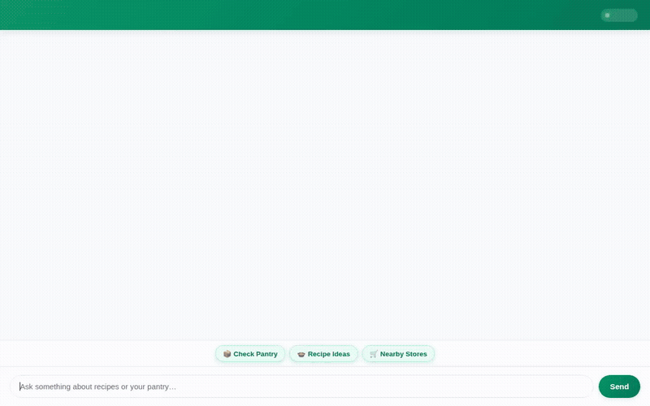

# 👨‍🍳 Smart Pantry Chef

An intelligent, AI-powered culinary assistant built with the **Google Agent Development Kit (ADK)**. Smart Pantry Chef helps users track pantry inventory, suggest recipes based on available ingredients, generate studio-quality dish photography and short culinary videos, and locate nearby grocery stores.



---

## 🌟 Key Features & Capabilities

Smart Pantry Chef integrates with Google Cloud services and specialized tools:

- 📦 **Pantry Inventory Management (Firestore)**:
  - Add, update, and inspect food items in a live Firestore NoSQL database (`pantry_inventory` collection).
- 🍲 **Smart Recipe Matching & Online Search**:
  - Match recipe ideas to your exact pantry inventory or search thousands of online recipes via TheMealDB API.
- 🎨 **AI Dish Photography (Gemini Image Generation)**:
  - Generates realistic food photography using `gemini-3.1-flash-lite-image`, uploads images to public Google Cloud Storage, and renders them in rich UI cards.
- 🎥 **Culinary Video Generation (Gemini Omni)**:
  - Creates short culinary videos for dishes using Google's `gemini-omni-flash-preview` model in the global region.
- 📍 **Store & Market Locator (Google Maps Platform)**:
  - Geocodes addresses and searches nearby grocery stores, supermarkets, and specialty food markets via Google Maps Places API.
- 🧠 **Dietary & Allergy Memory Bank**:
  - Automatically recalls user dietary preferences, restrictions, and allergies across sessions using Vertex AI Memory Bank (`PreloadMemoryTool` and `LoadMemoryTool`).
- 🎨 **Generative A2UI (Agent-to-User Interface v0.8)**:
  - Dynamically renders structured UI cards, text lists, and image layouts instead of raw text.
- ⚡ **Secure Code Execution**:
  - Runs calculations and custom data processing in an isolated `AgentEngineSandboxCodeExecutor`.

---

## ☁️ Google Cloud Architecture

- **Vertex AI Reasoning Engine / Agent Engine**: Hosts the deployed ADK agent runtime.
- **Google Cloud Firestore**: Persists real-time pantry inventory.
- **Google Cloud Storage (GCS)**: Stores generated media assets (dish images and video clips).
- **Google Maps Platform**: Powers address geocoding and local grocery search.
- **Google Cloud Run**: Serverless container runtime hosting the FastAPI proxy and chat interface.

---

## 🛠️ Project Structure

```text
.
├── app/
│   ├── agent.py            # Main ADK Agent definition & tool registry
│   ├── a2ui_utils.py       # A2UI v0.8 schema callback & renderer
│   ├── firestore_db.py     # Firestore database operations
│   ├── image_tool.py       # Gemini image generation & GCS uploader
│   ├── video_tool.py       # Gemini Omni video generation & GCS uploader
│   ├── maps_tools.py       # Google Maps Places & Geocoding tools
│   ├── recipe_tools.py     # Ingredient recipe search
│   ├── themealdb_tool.py   # TheMealDB online recipe search
│   └── fast_api_app.py     # FastAPI application entrypoint
├── frontend/
│   ├── main.py             # FastAPI proxy for Agent Engine A2A API
│   ├── Procfile            # Cloud Run buildpack entrypoint
│   └── static/index.html   # Plain HTML/CSS/JS branded chat interface
├── tests/
│   └── unit/               # Pytest unit test suite
├── agents-cli-manifest.yaml # Agent deployment metadata
└── demo.gif                # Looping inline demo animation
```

---

## 🚀 Local Setup & Running

### Prerequisites

- Python 3.11+ or `uv`
- Google Cloud Project with Vertex AI, Firestore, and Cloud Storage enabled
- `GOOGLE_MAPS_API_KEY` (for store locator features)

### 1. Install Dependencies

```bash
pip install -r requirements.txt
```

### 2. Configure Environment Variables

```bash
export GOOGLE_CLOUD_PROJECT="YOUR_PROJECT_ID"
export GOOGLE_MAPS_API_KEY="MAPS_KEY"
export AGENT_ENGINE_RESOURCE_NAME="projects/YOUR_PROJECT/locations/LOCATION/reasoningEngines/YOUR_ENGINE_ID"
export AGENT_DIRECTORY="app"
```

### 3. Run the Agent Server Locally

To start the ADK agent FastAPI backend:

```bash
uv run uvicorn app.fast_api_app:app --host 0.0.0.0 --port 8000
```

### 4. Run the Custom Frontend

To start the chat UI frontend server locally:

```bash
cd frontend
python main.py
```

Open a web browser and navigate to `http://localhost:8080` (or `http://localhost:8000` for the ADK Playground).

---

## 🧪 Testing

Run the unit test suite with `pytest`:

```bash
uv run pytest tests/unit
```

---

## 📄 License

Apache License 2.0
